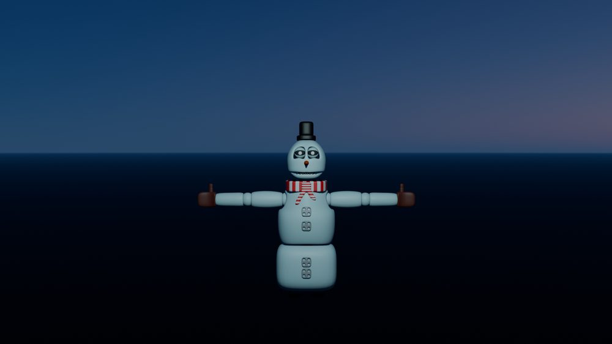

# Cómo terminar tu portafolio

`index.html` ya tiene la estructura completa en 4 partes: **Inicio, Desarrollo,
Desenlace y Final**. Solo falta que reemplaces los placeholders por tu contenido real.

## 1. Organiza tus archivos

```
portafolio/
├── index.html
└── assets/
    ├── inicio/       → tu retrato o foto de presentación (retrato.jpg)
    ├── desarrollo/   → modelo-01.jpg ... modelo-06.jpg (6 imágenes)
    └── desenlace/    → modelo-01.jpg ... modelo-04.jpg (4 imágenes)
```

## 2. Reemplaza cada imagen

Cada tarjeta tiene un comentario justo arriba del placeholder, por ejemplo:

```html
<!-- Reemplaza esto por:  -->
<span class="ph-text mono">assets/desarrollo/<br>modelo-01.jpg</span>
```

Borra el `<span class="ph-text">...</span>` y pega la línea ``, ajustando
el nombre del archivo y el texto `alt` (describe la imagen para accesibilidad).

## 3. Conecta cada modelo con su plataforma

Toda la tarjeta es un enlace: `<a class="piece" href="..." data-platform="Sketchfab">`.
Por cada modelo:

1. Cambia el `href="https://sketchfab.com/3d-models/TU-MODELO-1"` (o el que corresponda)
   por el link real del modelo en Sketchfab, ArtStation o Behance.
2. Cambia `data-platform="Sketchfab"` (aparece dos veces en cada tarjeta: en el `<a>`
   y en el `<figure>`) por la plataforma real — ese texto es el que se muestra al
   pasar el mouse sobre la imagen ("Ver en Sketchfab", "Ver en ArtStation", etc.).

Ya dejé una distribución de ejemplo alternando las tres plataformas en los 10 modelos
— cámbiala según dónde esté publicado cada uno realmente.

## 4. Edita los textos

- **Inicio**: la frase de apertura (cita o idea personal) y tu presentación.
- **Desarrollo** (6 modelos) y **Desenlace** (4 modelos): nombre y descripción de
  cada uno. En Desenlace la descripción puede ser un poco más larga — las tarjetas
  son más grandes.
- **Final**: la frase de cierre que invite a contactarte, y tus enlaces reales
  (correo, Instagram, LinkedIn, ArtStation, Behance, Sketchfab).
- `Tu Nombre` aparece en el menú, el Inicio y el pie de página — reemplázalo en los 3 lugares.

## 5. Revisa en el navegador

Abre `index.html` con doble clic, o súbelo tal cual a GitHub Pages, Netlify o cualquier
hosting estático — es un solo archivo, no necesita build ni instalación.

## Notas de diseño

- Estilo editorial de catálogo de arte: fondo papel cálido, tipografía serif (Piazzolla)
  para títulos y presentación, sans (Work Sans) para texto, y mono (Space Mono) para
  las etiquetas técnicas y la numeración de obras — pensado para sentirse profesional
  sin perder el carácter de artista.
- **Desarrollo** usa un grid de catálogo 3×2 (piezas en proceso), y **Desenlace** usa
  tarjetas más grandes de 2 columnas (piezas destacadas) para marcar la diferencia
  entre ambas secciones.
- **Final** cambia a fondo verde bosque oscuro para cerrar con un momento distinto,
  más directo y de contacto.
- Responsivo: el catálogo pasa a 2 columnas en tablet y 1 en celular; las tarjetas
  destacadas se apilan en una columna en pantallas angostas.
